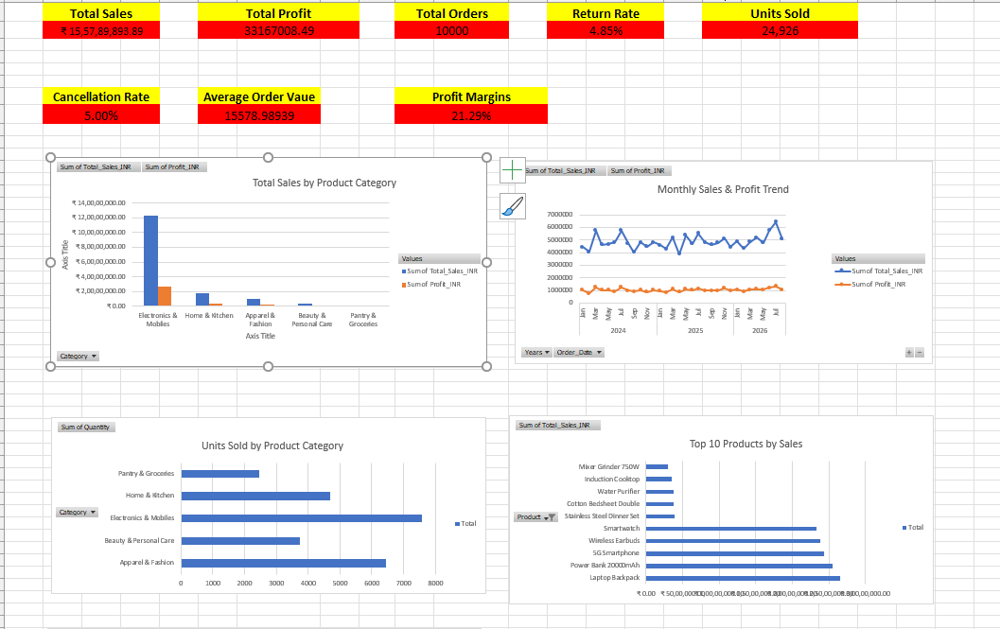
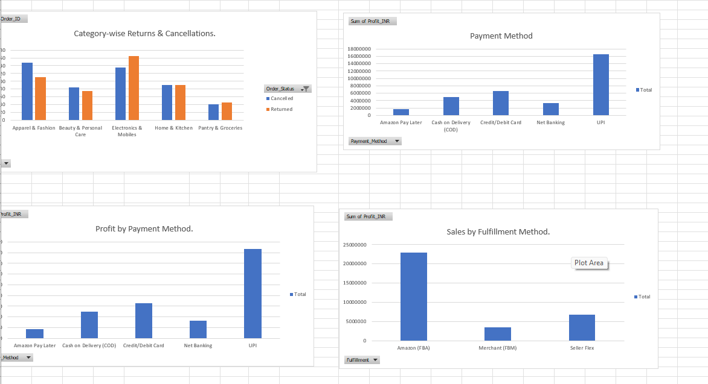
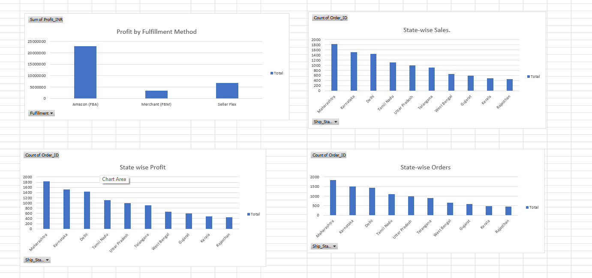

# E-commerce Sales Analytics Dashboard (Excel)

An Excel project that turns 10,000 e-commerce orders (Jan 2024 – Aug 2026) into an interactive KPI dashboard covering sales, profit, product mix, payment and fulfilment methods, state-wise performance, and order outcomes (delivered, shipped, returned, cancelled).

## Dashboard Preview

| Sales and profit analysis | Order status and state-wise analysis |
|---|---|
|  |  |

## 1. Project Overview

Raw order records are cleaned, validated, and summarized with PivotTables and PivotCharts into a single dashboard that a business stakeholder can use to monitor performance. The analysis answers where sales and profit come from, how healthy order fulfilment is, and where revenue is lost to returns and cancellations.

**Dataset:** 10,000 orders and 13 columns, provided by my internship company for analytics training. The original source is not specified, so the findings describe this dataset only and should not be treated as official Amazon or marketplace performance.
**Period covered:** 1 Jan 2024 – 30 Aug 2026 (32 months)
**Tools:** Microsoft Excel (PivotTables, PivotCharts, formulas)

## 2. Business Questions

1. How much sales and profit does the business generate, and at what margin?
2. Which product categories and products drive revenue?
3. How do sales and profit trend month by month?
4. Which payment methods, fulfilment methods, and states contribute the most?
5. What share of orders is delivered, shipped, returned, or cancelled, and how much revenue do returns and cancellations affect?
6. Where are returns and cancellations most concentrated?

## 3. Dataset

| Column | Description |
|---|---|
| Order_ID | Unique order identifier |
| Order_Date | Date the order was placed |
| Category, Product | Product category (5) and product name |
| Quantity, Unit_Price_INR, Discount_Pct | Units ordered, list price in ₹, discount applied (0–25%) |
| Total_Sales_INR | Order value after discount |
| Profit_INR | Profit on the order |
| Payment_Method | UPI, Credit/Debit Card, Cash on Delivery, Net Banking, Amazon Pay Later |
| Fulfillment | Amazon (FBA), Seller Flex, Merchant (FBM) |
| Order_Status | Delivered, Shipped, Returned, Cancelled |
| Ship_State | Destination state (10 states) |

**Data checks performed:** no missing values; no duplicate Order IDs; no zero or negative quantity, sales, or profit; `Total_Sales_INR = Quantity × Unit_Price × (1 − Discount)` holds on every row; all order dates fall within the expected range (date verification in the *Calculations* sheet).

**KPI definitions**
- **Total Sales** = sum of `Total_Sales_INR` across *all* orders, including returned and cancelled ones (gross order value).
- **Profit Margin** = Total Profit ÷ Total Sales. Returned and cancelled orders carry zero profit.
- **Average Order Value** = Total Sales ÷ Total Orders.
- **Return Rate / Cancellation Rate** = returned (or cancelled) orders ÷ total orders.

## 4. Key Performance Indicators

| KPI | Result |
|---|---:|
| Total Sales | ₹15,57,89,893.89 (≈ ₹15.58 crore) |
| Total Profit | ₹3,31,67,008.49 (≈ ₹3.32 crore) |
| Total Orders | 10,000 |
| Units Sold | 24,926 |
| Average Order Value | ₹15,578.99 |
| Profit Margin | 21.29% |
| Return Rate | 4.85% |
| Cancellation Rate | 5.00% |

## 5. Key Findings

### 5.1 Product categories and products

| Category | Orders | Sales | Share of sales | Profit | Margin | Units | Avg. order value |
|---|---:|---:|---:|---:|---:|---:|---:|
| Electronics & Mobiles | 3,045 | ₹12.36 cr | 79.3% | ₹2.63 cr | 21.3% | 7,579 | ₹40,581 |
| Home & Kitchen | 1,888 | ₹1.80 cr | 11.5% | ₹38.4 lakh | 21.3% | 4,684 | ₹9,520 |
| Apparel & Fashion | 2,580 | ₹98.3 lakh | 6.3% | ₹20.9 lakh | 21.2% | 6,452 | ₹3,810 |
| Beauty & Personal Care | 1,499 | ₹28.9 lakh | 1.9% | ₹6.0 lakh | 20.9% | 3,734 | ₹1,927 |
| Pantry & Groceries | 988 | ₹15.3 lakh | 1.0% | ₹3.3 lakh | 21.6% | 2,477 | ₹1,546 |

- **Electronics & Mobiles generates 79% of sales and 79% of profit** from 30% of units. Profit margin is almost identical across all categories (about 21%), so Electronics leads because of its high order value (₹40.6K average vs ₹1.5K–₹9.5K elsewhere), not because it is more profitable per rupee.
- **Apparel & Fashion is second by units (25.9%) but only 6.3% of sales**, a high-volume, low-ticket category.
- **The five best-selling products are all in Electronics & Mobiles:** Laptop Backpack (₹2.65 cr), Power Bank 20000mAh (₹2.55 cr), 5G Smartphone (₹2.43 cr), Wireless Earbuds (₹2.38 cr), and Smartwatch (₹2.33 cr). Together they account for 79.3% of total sales. Places 6 to 10 are all Home & Kitchen products (led by Stainless Steel Dinner Set, ₹38.7 lakh).

### 5.2 Trend over time
- Average monthly sales were about ₹47.5 lakh in 2024 and ₹47.9 lakh in 2025. Across Jan–Aug 2026 the average rose to ₹51.7 lakh (about +8% vs 2025). *2026 has only 8 months of data, so monthly averages are used instead of yearly totals.*
- The highest month is **July 2026 (₹64.4 lakh)**, followed by June 2026 (₹57.7 lakh). The lowest is April 2025 (₹38.9 lakh).
- Profit moves in step with sales; the monthly margin stays in a narrow band of roughly 19–23%.

### 5.3 Order outcomes

| Order status | Orders | Share | Sales value |
|---|---:|---:|---:|
| Delivered | 8,147 | 81.47% | ₹12.59 cr |
| Shipped | 868 | 8.68% | ₹1.42 cr |
| Cancelled | 500 | 5.00% | ₹76.9 lakh |
| Returned | 485 | 4.85% | ₹79.6 lakh |

- Cancelled and returned orders together represent **₹1.56 crore, about 10% of reported sales**. Profit on these orders is zero. Excluding them, sales are ₹14.01 crore and the margin rises from 21.29% to 23.67%.
- **845 of the 868 "Shipped" orders are more than 30 days old (513 are over a year old)** relative to the last order date in the data. Either the status is not being updated after delivery or these orders are stuck in transit; the data cannot tell which.

### 5.4 Returns and cancellations by category

| Category | Cancelled | Returned | Cancellation rate | Return rate |
|---|---:|---:|---:|---:|
| Electronics & Mobiles | 136 | 164 | 4.5% | **5.4%** |
| Apparel & Fashion | 148 | 110 | **5.7%** | 4.3% |
| Beauty & Personal Care | 84 | 75 | 5.6% | 5.0% |
| Home & Kitchen | 91 | 90 | 4.8% | 4.8% |
| Pantry & Groceries | 41 | 46 | 4.2% | 4.7% |

- Electronics has the highest return rate and accounts for **79% of the ₹1.56 crore** of returned and cancelled sales, simply because each order is worth far more.
- Apparel & Fashion has the highest cancellation rate. Rates across categories fall in a narrow 4–6% band.

### 5.5 Payment methods

| Payment method | Orders | Sales | Share of sales | Profit | Margin | Return rate | Cancel rate |
|---|---:|---:|---:|---:|---:|---:|---:|
| UPI | 4,972 | ₹7.85 cr | 50.4% | ₹1.67 cr | 21.2% | 4.9% | 5.0% |
| Credit/Debit Card | 2,074 | ₹3.11 cr | 19.9% | ₹65.3 lakh | 21.0% | 5.5% | 5.6% |
| Cash on Delivery | 1,458 | ₹2.31 cr | 14.8% | ₹50.1 lakh | 21.7% | 3.6% | 5.4% |
| Net Banking | 1,024 | ₹1.54 cr | 9.9% | ₹32.9 lakh | 21.4% | **6.1%** | 3.4% |
| Amazon Pay Later | 472 | ₹76.8 lakh | 4.9% | ₹16.9 lakh | 22.0% | 3.2% | 4.5% |

- **UPI accounts for half of all sales and profit.** Digital payments (UPI, card, net banking) make up about 80% of sales.
- Net Banking and Card orders have the highest return rates; COD and Pay Later have the lowest. Pay Later has a small sample (472 orders).

### 5.6 Fulfilment methods

| Fulfilment | Orders | Sales | Share of sales | Profit | Margin | Delivered | Return rate | Cancel rate |
|---|---:|---:|---:|---:|---:|---:|---:|---:|
| Amazon (FBA) | 7,054 | ₹10.75 cr | 69.0% | ₹2.29 cr | 21.3% | 82.0% | 4.8% | 4.5% |
| Seller Flex | 1,966 | ₹3.12 cr | 20.0% | ₹68.2 lakh | 21.8% | 81.1% | 4.9% | **6.3%** |
| Merchant (FBM) | 980 | ₹1.71 cr | 11.0% | ₹34.7 lakh | **20.3%** | **78.4%** | 5.3% | 5.6% |

- **FBA handles 69% of sales and has the best fulfilment record** (highest delivered share, lowest cancellation rate).
- **Merchant (FBM) is the weakest:** lowest margin (20.3%), lowest delivered share (78.4%), and the highest share of orders left in "Shipped" status (10.7%).
- Seller Flex has the highest cancellation rate (6.3%).

### 5.7 State-wise performance

| State | Orders | Sales | Share of sales | Profit | Margin | Return rate | Cancel rate |
|---|---:|---:|---:|---:|---:|---:|---:|
| Maharashtra | 1,840 | ₹2.96 cr | 19.0% | ₹63.0 lakh | 21.3% | 5.1% | 5.2% |
| Karnataka | 1,515 | ₹2.44 cr | 15.7% | ₹52.7 lakh | 21.6% | 4.8% | 5.0% |
| Delhi | 1,444 | ₹2.24 cr | 14.4% | ₹47.0 lakh | 21.0% | 4.9% | 5.0% |
| Tamil Nadu | 1,109 | ₹1.79 cr | 11.5% | ₹38.6 lakh | 21.6% | 4.9% | 4.4% |
| Uttar Pradesh | 991 | ₹1.41 cr | 9.1% | ₹29.8 lakh | 21.1% | 4.7% | 5.7% |
| Telangana | 906 | ₹1.40 cr | 9.0% | ₹29.4 lakh | 21.1% | **5.7%** | 4.8% |
| West Bengal | 665 | ₹1.09 cr | 7.0% | ₹23.4 lakh | 21.6% | 4.2% | 4.8% |
| Gujarat | 591 | ₹93.7 lakh | 6.0% | ₹20.1 lakh | 21.4% | 4.1% | 5.3% |
| Rajasthan | 456 | ₹66.2 lakh | 4.3% | ₹13.8 lakh | 20.9% | 5.5% | **5.9%** |
| Kerala | 483 | ₹66.1 lakh | 4.2% | ₹13.8 lakh | 20.8% | 3.7% | 4.1% |

- **Maharashtra, Karnataka, and Delhi contribute 49% of sales;** the top five states contribute about 70%.
- Profit ranking matches sales ranking, and margins differ by less than one percentage point between states.
- Telangana has the highest return rate and Rajasthan the highest cancellation rate, but each state has under 1,000 orders, so small differences should be read with care.

## 6. Business Recommendations

1. **Reduce dependence on five products.** Electronics & Mobiles, and specifically five products, produce about 79% of sales and profit. Keep these in stock and priced competitively, and test ways to grow Home & Kitchen, which is the next largest category and has the same margin.
2. **Target Electronics returns first.** It has the highest return rate (5.4%) and the largest returned value (₹64.4 lakh). Review product descriptions, packaging, and quality complaints for the top five products before looking at other categories.
3. **Review Merchant (FBM) and Seller Flex fulfilment.** FBM has the lowest margin and delivery rate, and Seller Flex has the highest cancellation rate. Compare their processing and shipping times with FBA.
4. **Audit the "Shipped" backlog.** 845 orders worth about ₹1.4 crore have been in "Shipped" status for over 30 days. Confirm whether the status is simply not being updated, and fix the tracking or follow up with the carrier.
5. **Look at payment-linked returns.** Net Banking (6.1%) and card (5.5%) orders return more often than COD (3.6%). Check whether this is linked to order value or product mix before acting.
6. **Use low-ticket categories as add-ons.** Pantry, Beauty, and Apparel are high-volume, low-value categories. Bundling them with high-value orders is a way to raise average order value.
7. **Watch Rajasthan and Telangana** for returns and cancellations, and prioritize growth in the top three states, which already hold 49% of sales.

## 7. Limitations

- **Findings are descriptive.** They show where patterns exist but do not establish why returns, cancellations, or margin differences occur.
- **Sales are gross order values** and include returned and cancelled orders (about 10% of sales). Profit on those orders is zero, which lowers the overall margin.
- **Differences between groups are small.** Margins, return rates, and cancellation rates are very similar across categories, states, and payment methods, which is typical of a training dataset. Treat rankings as indicative, not conclusive.
- **Unit prices vary widely within the same product** (for example, one product's price ranges from under ₹1,000 to about ₹35,000), so product-level pricing conclusions are unreliable.
- **2026 covers 8 months only.** The dataset has no customer IDs or cost data, so customer-level analysis such as repeat purchases or retention is not possible.
- **The original source of the data is unknown.** Results illustrate the analysis approach and should not be generalized to a real business.

## 8. Skills Demonstrated

- Data validation and quality checks on a 10,000-row dataset
- KPI design and calculation (margin, AOV, return and cancellation rates)
- PivotTables and PivotCharts: multi-dimensional summaries by category, product, month, payment method, fulfilment method, state, and order status
- Dashboard design in Excel
- Business interpretation and recommendations, with limitations stated

## 9. Project Files

| File | Description |
|---|---|
| `Amazon Sales Data India copy.xlsx` | Workbook with raw data (`Raw_Data`), KPI summary (`Overall_performance`), PivotTables, and the `Dashboard` sheet |
| `dashboard-overview.png` | KPI cards and headline charts |
| `dashboard-sales-analysis.png` | Category returns and cancellations, payment method, and fulfilment charts |
| `dashboard-orders-states.png` | Fulfilment profit and state-wise charts |

## 10. Conclusion

This project shows how Excel can turn raw order data into a decision-ready dashboard: it reports headline KPIs, identifies the concentration of revenue in Electronics & Mobiles, compares payment, fulfilment, and geographic performance, and quantifies where revenue is lost to returns, cancellations, and stalled shipments, with clear recommendations and stated limitations.
